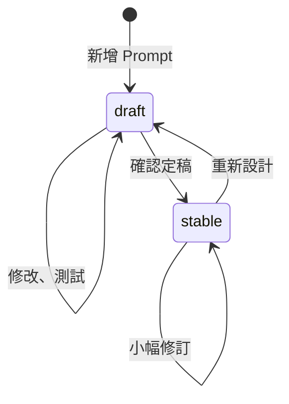

# Prompt Studio

## Prompt 狀態流程

目前使用兩個狀態：`draft`（草稿／測試中）及 `stable`（已定稿，可日常使用）。



- `draft`：尚未定稿，可反覆修改及測試。
- `stable`：已確認可使用；仍可修訂，必要時退回 `draft`。
- `status` 表示成熟程度；`version` 表示修訂版本。建議初稿使用 `0.x.x`，首次定稿使用 `1.0.0`。
- 這是**管理約定**，不是程式強制執行的狀態機。目前網站只顯示狀態，不會自動驗證轉換。
- 每次修改請更新 `updated_at`（同一天修改時日期可能不變）；Git Commit 保留詳細歷史。
- Prompt 不會因為進入 `stable` 而刪除或停止顯示。

個人 Prompt Library。使用 GitHub 儲存 Prompt 原始檔，GitHub Pages 顯示唯讀網站。

## 專案結構

- `prompts/p0001.md` 等：YAML metadata + Markdown Prompt，為正式資料來源
- `scripts/build.py`：產生 `docs/prompts.json`
- `docs/`：靜態前端，提供搜尋、篩選、複製及下載
- `.github/workflows/deploy.yml`：Prompt 修改時重新產生索引

## 啟用 GitHub Pages

在 Repository → Settings → Pages，選擇 Deploy from a branch，指定 `main` 和 `/docs`。

在 Settings → Actions → General → Workflow permissions，允許 GitHub Actions 寫入內容，才能自動提交更新後的 JSON。

## 更新 Prompt

修改 `prompts/p0001.md` 等 Markdown 原始檔，更新 `updated_at` 日期（YYYY-MM-DD）。GitHub Actions 將重建索引。新增 Prompt 時，使用不重複的穩定 ID。

## 本機預覽

```sh
cd docs
python -m http.server 8000
```

瀏覽 http://localhost:8000。

## 安全

Repository 為公開，勿提交私人逐字稿、公司機密、API Token 或其他敏感資訊。示範 Prompt 並非完整正式版本。
